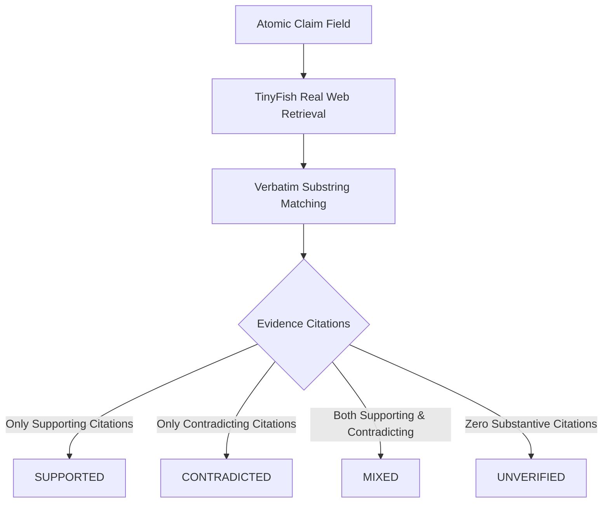

# PROOFTRAIL AI — Real-Data Integrity Policy

**Effective Date:** 2026-10-30  
**Version:** 1.0  
**Enforcement:** Automated Server-Side & Client-Side Verification

---

## 1. Core Mission & Integrity Mandate

ProofTrail AI is built on a single, uncompromising principle: **forensic fact verification must be rooted strictly in real, verifiable information retrieved from authentic web sources.**

A fact-checking platform that fabricates citations, hallucinates quotations, or simulates successful investigations when external services fail defeats its own purpose. ProofTrail AI does not generate "vibe checks" or synthetic opinions. Every conclusion must be grounded in an auditable trail of evidence.

---

## 2. Ten Invariant Evidence Rules

1. **Authentic Source Origin**: Every displayed evidence quotation must originate from a real web source retrieved via TinyFish. Synthetic or hallucinated sources are rejected.
2. **URL & Title Preservation**: The original requested URL, the final resolved URL (post-redirect), and the publisher’s authentic page title must be preserved in the audit ledger without modification.
3. **Exact Substring Verification**: All evidence quotations are verified against the raw retrieved DOM text using exact substring matching. If an extracted quote does not appear verbatim in the source text, it is immediately discarded. Paraphrased or altered quotes are never attributed to a source.
4. **Retrieval Timestamps**: The exact UTC timestamp of retrieval (`accessed_at`) is recorded for every source.
5. **No Invented Publication Dates**: Publication dates (`published_at`) are recorded only when explicitly stated in page metadata or microdata. If a source does not report a publication date, it is labeled `"Date not reported"`. Dates are never assumed, interpolated, or fabricated.
6. **Support Requires Material Evidence**: A source is never classified as supporting a claim field unless its actual retrieved content directly substantiates that specific field.
7. **Explicit Evidence Relationships**: The system strictly categorizes evidence into:
   - `SUPPORTS`: Direct, unambiguous factual corroboration.
   - `CONTRADICTS`: Direct, conflicting factual statements.
   - `CONTEXT`: Relevant background or circumstantial details.
8. **Default to UNVERIFIED**: If retrieved sources contain insufficient information to establish a claim, or if no public sources can be found, the status must remain `UNVERIFIED`.
9. **Missing Evidence $\neq$ Falsity**: Missing or unreachable evidence must never be interpreted as proof that a claim is false. Missing evidence indicates only that the investigation could not verify the claim.
10. **Fail Loudly & Honestly**: If TinyFish is unreachable, rate-limited, or unconfigured, the application returns an explicit HTTP 503 error explaining the dependency failure. It will never silently fall back to simulated reports or mock search results.

---

## 3. The Four Status System

Every atomic claim field is classified into one of four mutually exclusive statuses:

### 1. SUPPORTED
- **Criteria**: One or more reliable retrieved web sources contain exact verbatim passages confirming the atomic claim.
- **Example**: The official government portal states: *"The stipend value is ₹50,000 for approved college scholars."*

### 2. CONTRADICTED
- **Criteria**: One or more reliable retrieved web sources contain exact verbatim passages that directly conflict with the atomic claim.
- **Example**: The ministry bulletin states: *"Applications closed on 15 October; no extensions have been granted."* (Directly conflicting with a claim of a 30 November deadline).

### 3. MIXED
- **Criteria**: Material evidence from multiple authoritative sources presents conflicting or irreconcilable information.
- **Example**: Official source A states the grant applies to *"all full-time students"*, while official source B states it is *"restricted to state domicile residents only"*.

### 4. UNVERIFIED
- **Criteria**: The retrieved web sources do not contain sufficient specific statements to corroborate or disprove the claim, or no safe public sources could be retrieved.
- **Rule**: Never convert `UNVERIFIED` to `CONTRADICTED` simply because proof was not found.

---

## 4. Separation of Automated Tests vs. Production Data

- **Automated Test Fixtures**: Backend unit tests (such as `test_mocked_end_to_end_investigation_pipeline` in `backend/test_main.py`) use clearly labeled mock fixtures to verify parser logic and state transitions in offline CI environments.
- **Customer Production Flow**: In production, mock fixtures are strictly prohibited from entering customer investigation databases, workspace dashboards, or audit export ledgers.
